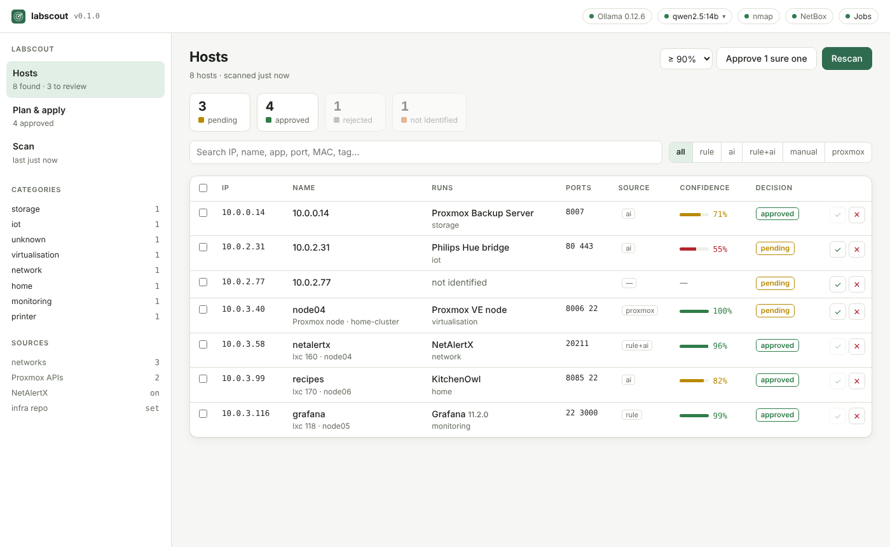
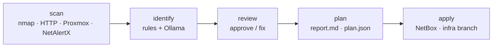
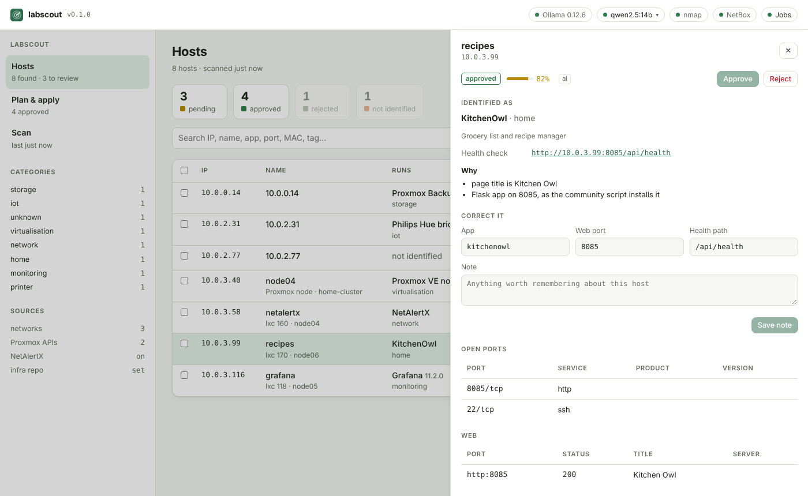
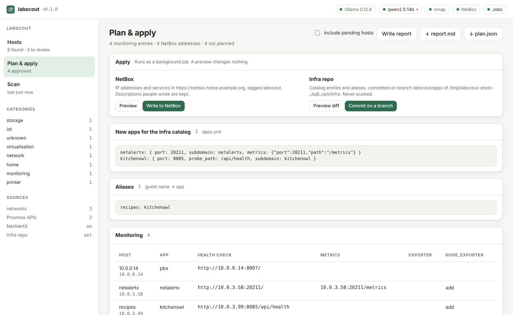
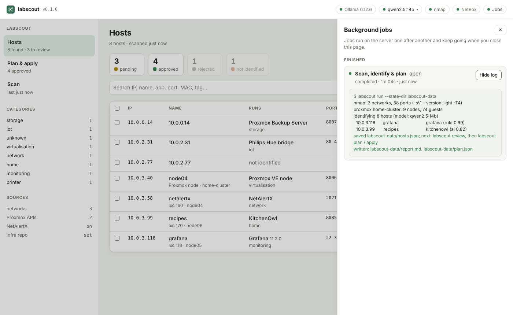
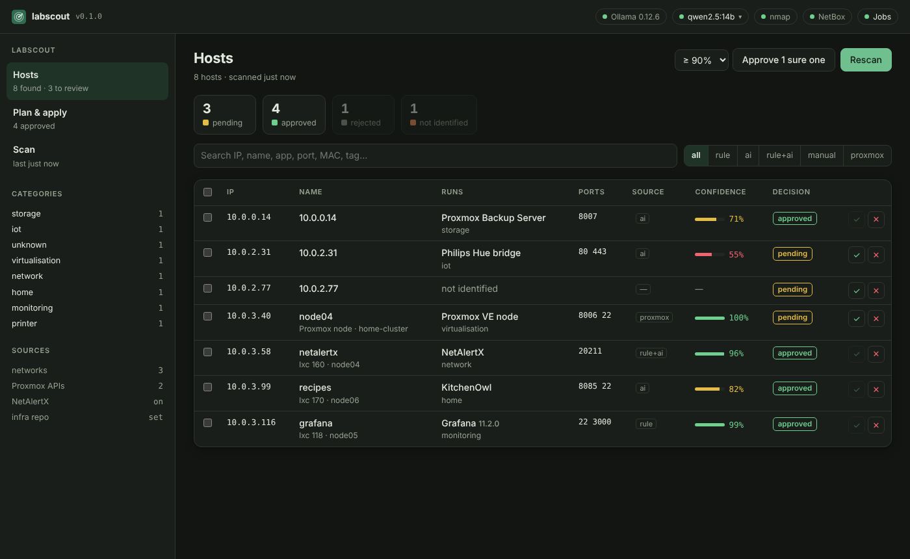

# labscout

labscout finds out what runs in your homelab and turns that into a monitoring and NetBox plan.
A local [Ollama](https://ollama.com) model does the identification work, so no scan data leaves
your network.

- **Discovery** combines several sources. nmap service versions, HTTP fingerprints, guest names
  from the Proxmox API and device names from NetAlertX are merged into one record per host.
- **Identification** starts with about 65 fingerprint rules. Only hosts the rules leave unclear go
  to the model, which must answer in a strict JSON schema. Guard rails drop ports the model
  invents, and answers are cached per host fingerprint.
- **You stay in control.** Nothing is planned until you approve it, and `apply --infra` only
  commits on a branch, never pushes.

## Screenshots

| | |
|---|---|
|  |  |
| Everything found about a host, and the form to correct it | The plan: catalog entries, aliases, monitoring and NetBox |
|  |  |
| Scans run in the background with a live log | Follows your system's dark mode |

Start with [Install](getting-started/install.md).
