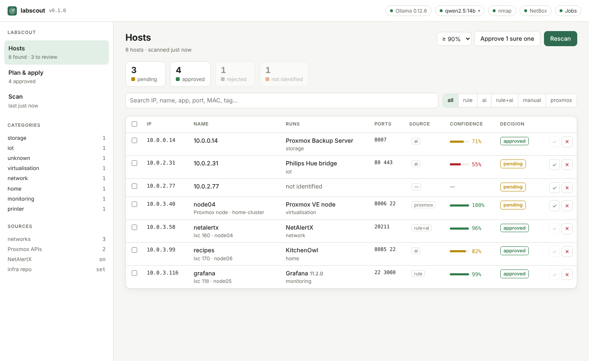
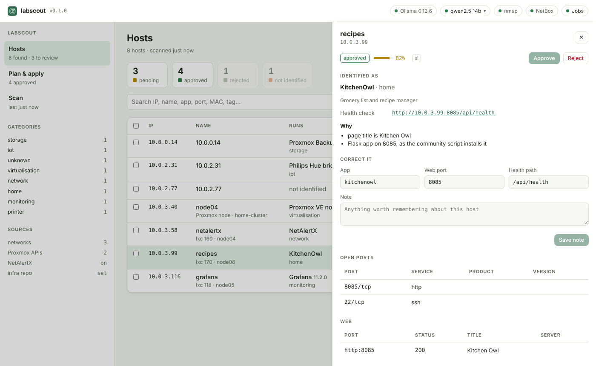
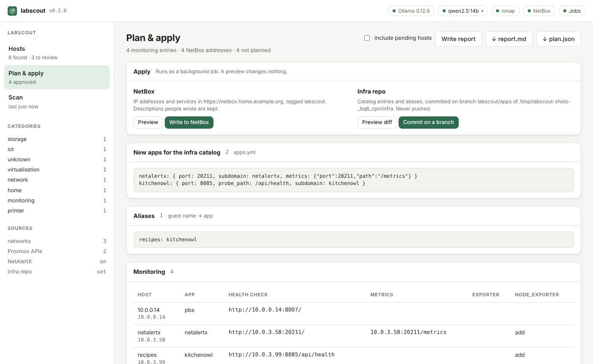
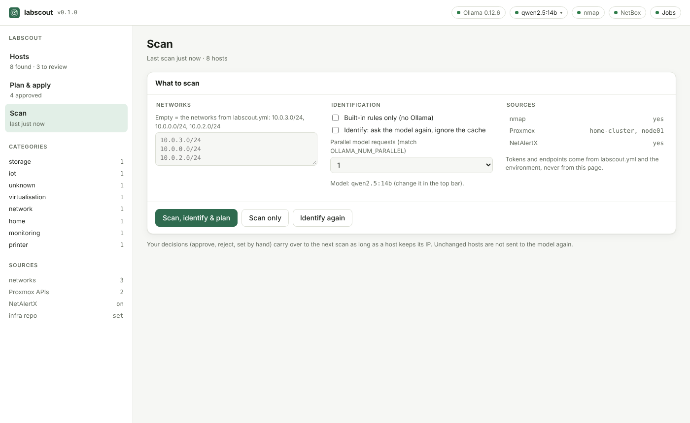
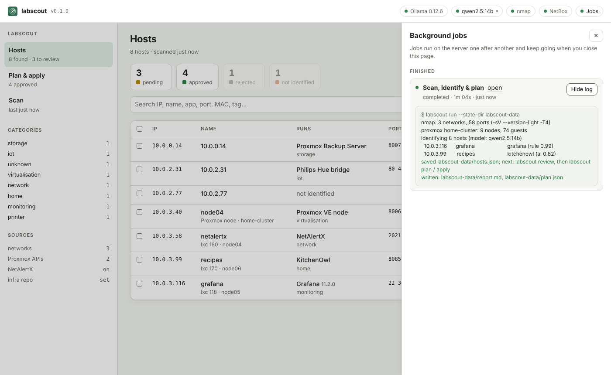
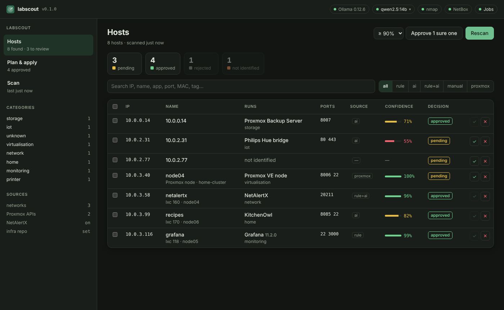

# Web UI

```bash
labscout serve                       # http://localhost:8766/?token=…
labscout serve --bind 0.0.0.0        # reachable from the LAN
labscout serve --no-auth             # no token, only allowed on localhost
```

The UI is a React app that ships inside the Python package, so it needs no Node.js and loads
nothing from a CDN. It has three pages.

## Hosts



**Hosts** lists every host with what it runs, the open ports, how it was identified (`rule`,
`ai`, `rule+ai`, `proxmox` or `manual`), the confidence and your decision.

- Click the pending, approved, rejected or "not identified" counters to filter. You can also
  search on IP, name, app, port, MAC or Proxmox tag, or filter by source and category.
- Approve or reject a host with ✓ and ✕. To do several at once, select them and use the bulk
  bar. **Approve sure ones** approves every pending host at or above the confidence you pick.
- Click a host to see everything that was found: ports, web pages, Proxmox guest, MAC vendor
  and the model's reasons. You can correct the app, web port and health path there. Saving
  marks the host as identified by hand and approves it.



## Plan & apply



**Plan & apply** shows the catalog entries, aliases, monitoring targets, NetBox addresses and
the hosts nobody could identify. Use **Preview** first, then write to NetBox or commit to the
infra branch after a confirmation. You can download `report.md` and `plan.json` from here.

## Scan



**Scan** runs "scan, identify & plan", a scan only, or identification again. You can scan
other networks than the configured ones, skip the model, ignore the cache or ask the model
several things in parallel.

## Jobs



Scans and applies run in the background, one at a time, and keep going when you close the page.
The **Jobs** button in the top bar shows running, waiting and finished jobs with their live
logs. A waiting job can be removed and a running one cancelled. While a scan rewrites the
results, host edits wait until it is done.

## Model

The UI follows your system's light or dark mode.



The model pill in the top bar lists the models your Ollama has. The model you pick there is
used for every new scan and survives restarts (`labscout-data/settings.json`). Choose
**Use default** to go back to `model` in `labscout.yml` or `$LABSCOUT_MODEL`.

## Security

- Access needs a token. It comes from `LABSCOUT_WEB_TOKEN`, or labscout generates one and
  prints the login URL. After the first visit the token is kept in an HttpOnly, SameSite=Strict
  cookie. Scripts can send `Authorization: Bearer <token>` instead.
- Every change needs the `X-Labscout: 1` header and a same-origin request, which stops
  cross-site requests. The page has a strict Content-Security-Policy.
- The browser can only choose whitelisted options: networks (no larger than /16), model name,
  workers, cache and dry-run flags. The Ollama host, tokens, state directory and config file
  always come from the server's config and environment.

!!! warning
    Put the UI behind your reverse proxy with TLS (for example Traefik with CrowdSec) when you
    bind it to anything other than localhost.
